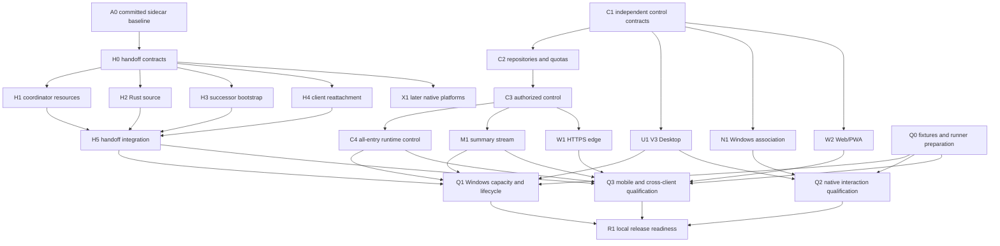

# AI command center parallel implementation plan

- Status: Execution decomposition; no new product milestone is accepted by this plan.
- Source checkpoint: accepted sidecar candidate `0d8e7f6090427bf85989296bf7212f145a2e2f86`; A0 is complete and H0 is next.
- Basis: [remaining work](ai-command-center-remaining-work.md), [requirements](ai-command-center-requirements.md), [idle handoff](ai-command-center-idle-handoff.md), [control contracts](ai-command-center-control-contracts.md), [Host capability matrix](ai-command-center-host-parity.md).
- Priority names below follow the active delivery sequence (P0 handoff, P1 control/quota, P2 monitoring/Desktop, P3 native/browser/mobile, P4 qualification), not the older proposal's phase numbering.

## Current evidence and immediate dependency

Windows owner discovery, native execution fencing, durable restricted recovery
and the non-expiring coordinator admission foundation are accepted in committed
slices. Sidecar quiescence is accepted at clean candidate `0d8e7f609` with
399 runtime/boundary/event-coalescing tests, 23 consumer/fence/exit tests,
4 shared-contract tests, source typecheck and 205-file configured lint.
The [clean process report](ai-command-center-p0-evidence/sidecar-handoff-after.json)
passes five checks with confirmed cleanup and one local deterministic provider
request. It includes the final retirement-identity guard. Build inputs and
retained failure evidence are linked in the remaining-work register. These
results do not qualify complete application transfer or future changes.

A0 is complete. H0 may now consume that committed sidecar baseline; C1 and Q0
remain independent ready work. No worker consumes another worktree's
uncommitted source or generated output.

## Fixed scope and constraints

- Windows first; same-machine, current-user, explicit idle-only Desktop to
  background Host transfer. No automatic interruption, model/tool replay,
  privileged service installation or elevation.
- Preserve Electron presentation, Node Agent execution and Rust authoritative
  storage/native ownership. Only Rust mutates SQLite and durable journals.
- Every execution owner and entry point must be inventoried. Unknown state,
  unresolved cleanup or unqualified containment refuses handoff. A successfully
  cancelled local request, disposed object or missing PID is not exit proof.
- Three admitted workspaces; 12 simultaneous main/child/Worker executions per
  workspace and 36 per Host. Queued work does not count as simultaneous runtime;
  waits, stopping and uncertain admitted starts retain their reservations until
  authoritative evidence permits release. Keep ten native children per session
  and the 32-RPC native guard.
- No automatic receipt/journal deletion in the first release. Bound hot caches,
  paginate retained history, and preserve identities across session/task deletion.
- Keep V3: no global left sidebar; top Overview/History/Settings icons; Host
  status top-right; monitor upper-left; A/B/C tabs upper-right. The two lower
  overview areas remain undefined and noninteractive.
- Reuse installed dependencies. D: is constrained; put intermediate bundles,
  profiles, binaries/PDBs and logs in C: session scratch. No live Desktop/profile,
  paid provider or marketplace tests; no `verify:ui:*` without explicit request.
- Local implementation, isolated validation and previously authorized local
  commits continue within scope. Push, PR, remote merge, deployment and service
  installation remain separate delivery actions.

## Value and risk execution priority

This order allocates available implementation capacity; it does not introduce
new dependency edges or require every row to finish before the next row starts.
Use three factors in order: concrete user/data-safety benefit, number of blocked
downstream outcomes unlocked, and remaining change/verification cost. Among
equally useful ready tasks, prefer the smaller reversible change. Risk below is
the remaining delivery risk, not a claim that ownership code is inherently safe.
For example, A0 is low incremental risk because the remaining work is candidate
review/verification; H2/H3 still change authoritative ownership and stay high risk.
The labels are planning judgments, not measured probabilities or time estimates.

| Order | Work packages | Value / remaining risk | Why this position | Verifiable delivery and exit gate |
|---|---|---|---|---|
| 1 | A0 | Very high / low incremental | Convert substantial existing work into a dependable shared baseline; unblock handoff integration | One reviewed local implementation commit, exact source/base/binary/bundle/input identities, a clean five-scenario process report with confirmed cleanup, and retained failing evidence. Refresh the final retirement guard's process coverage; do not reuse the dirty report as clean acceptance |
| 2 | H0, C1 | High / low runtime, medium design risk | Explicit boundaries prevent four implementation lanes from inventing incompatible protocols | Committed versioned schemas/ports, transition and error matrix, producer/consumer fixtures for unknown fields, identity, revision, lost reply and cancellation. H0 consumes A0; C1 can start now on committed source |
| 3 | Q0 | High / low | Discover hardware/device and measurement blockers early instead of after implementation | A reproducible workload manifest, token-count verification, process-observer coverage and runner/device availability matrix. Prepare the harness now; expensive qualification waits for a stable integrated candidate |
| 4 | H1, H4 | High / medium | Close visible start/reattach races using existing ownership and snapshot mechanisms | Entry-point-to-owner coverage map plus coordinator adapters; client epoch/snapshot adapter; passing real public-entry tests for pending setup, stale responses, cancellation and reconnect without starting work. H1-H4 full acceptance still joins at H5 |
| 5 | H2, H3 | Very high / high | Authoritative source release and successor readiness are unavoidable critical-path work | Separate source-transition and target-bootstrap commits, populated-profile/crash/native-closure reports, exact identity/CAS/idempotency tests. No release before source closure and no target execution before qualified readiness. Develop in parallel after H0; do not defer merely because risk is high |
| 6 | H5 | Very high / medium integration risk | Complete the first user-visible handoff outcome before broadening rollout | A clean integration candidate, applicable HT-01..HT-15 scenario-to-evidence matrix, one-writer/one-owner proof, no-replay assertions and fixture cleanup. Any failed required case blocks enabling transfer, not independent work elsewhere |
| 7 | C2 | High / high data/concurrency risk | Establish the single authoritative basis for capacity and control history | Additive migration with populated upgrade/rollback/reopen results; transactional reservation/receipt tests; simultaneous 13th/37th admission refused, exactly-once release, retained unresolved reservations and no automatic receipt deletion. May use a free backend lane once C1 is committed |
| 8 | C3, C4 | High / high authorization/runtime risk | Deliver useful control while preventing cross-client or stale-generation effects | Authorized control and receipt API; all-entry quota matrix; real main/child/Worker user paths proving identity targeting, duplicate/lost requests, goal-consumption acknowledgements and stale-result fencing. Implement C3 before C4; owner-crash acceptance consumes H5 |
| 9 | M1, U1 | High / medium | Turn authoritative state into usable monitoring and V3 workspace interaction | Bounded summary stream plus V3 component paths; cursor-gap/resync/slow-client and focus/draft/history tests; i18n/accessibility verification. U1 can develop against committed C1 fixtures; accept the real product only after M1, C4 and H5 are integrated |
| 10 | W1, W2 | High multi-device value / high security and platform risk | Reuse established control semantics for browser/mobile rather than building a second control store | Authenticated HTTPS edge and responsive client, origin/CSRF/revocation/role test report, and cross-client receipt/resume scenarios. W2 fixture UI can progress after C1; real-device acceptance waits for W1, M1, C4, H5 and E4 |
| 11 | N1 | Scope-dependent value / high native integration risk | Limit work to nominated programs and preserve external-app ownership | Windows association adapter, explicit capability/refusal results and program-specific automated fixtures. No universal embedding claim; real program/RDP/DPI/IME acceptance requires E3 and U1 |
| 12 | Q1, Q2, Q3 | Very high release confidence / medium environment risk | Measure the stable product against explicit targets, independently per environment | Reproducible candidate-bound Windows capacity/lifecycle, native interaction and real-mobile reports. Meet the work-package thresholds; failed or missing target-machine/device evidence remains a failed/open gate, not a local-development substitute |
| 13 | R1 | High operational value / low code risk | Package proven behavior into a reviewable operating and release decision | Support matrix, migration/recovery runbook, artifact checksums and acceptance index with no unexplained required gaps. Draft incrementally; final readiness requires Q1-Q3. Publishing/deployment remains a separate action |
| 14 | X1 | Later-platform value / high platform risk | Follow the confirmed Windows-first sequence and avoid speculative OS work | Native macOS/Linux identity/containment adapters and runner-specific evidence; explicit unsupported capabilities until their own tests pass. Start only when scope and E5 runners are available |

### Quality gates attached to each delivery

1. Before implementation, name the observable behavior and invariants. For a
   confirmed defect, capture a failing repro before correction; for a new feature,
   record the absent baseline and test its real public entry point. Empty test
   selections and import failures are not executed regression coverage.
2. Run the smallest meaningful checks for changed behavior: strict contract tests
   at process boundaries, controlled async tests for admission/lifecycle races,
   populated migration/rollback tests for storage, and component interaction
   tests for UI. Preserve normal success paths as well as failure cases.
3. Perform one focused code-review pass per coherent implementation before
   candidate validation. Check ownership, permission direction, state across
   awaits, cancellation/timeout semantics, idempotency, compatibility and cleanup.
   Fix concrete in-scope findings and rerun affected checks; do not restart broad
   reviews or add unrelated cleanup.
4. Before dependent integration, consume committed producer/consumer contracts,
   refresh the private candidate against applicable remote main in its own
   worktree, and run the relevant real-process/user-path gate on a known commit.
   Share installed dependencies but isolate mutable test state. Existing evidence
   applies only while relevant executable inputs are unchanged.
5. Deliver source/base identity, changed files, commands/results, relevant artifact
   hashes, native cleanup evidence where applicable, skipped checks with reasons
   and remaining integration joins. A green unit test is not a claim of full
   application, native-platform or minimum-hardware acceptance.

Boundary coverage follows the changed surface, not a ritual full-suite run:
unknown/unsupported schemas, absent resources, invalid identity/revision,
duplicate or lost replies, restart/session switch during await, pre/post-fence
cancellation, denied native access, pending writes/approvals, counter release,
subscriber gaps and native-process cleanup. Existing retained receipts/journals
must survive session/task deletion; no new purge behavior is introduced.

### Efficient scheduling and stop conditions

- **Immediate capacity:** A0 is accepted. H0 is now the primary lane; independent
  C1 and Q0 preparation can use other lanes. Do not start all 22 packages at once.
- **After H0:** Give H1 and H4 the first available implementation slots because
  their incremental risk is lower; start H2 and H3 in the other two slots with
  contract/native-state tests first. All four converge at H5. Four is a maximum,
  not a requirement to create busywork or independent reviews of the same change.
- **Control lane:** C2 can overlap handoff work only with spare capacity and
  exclusive paths; C3 then C4 follow. Shared schema/migration/RPC registration
  stays integrator-owned. UI skeletons may consume frozen fixtures but do not
  displace unfinished ownership or quota blockers.
- **Validation cadence:** Fast relevant checks run during development. Broaden
  once for a completed coherent boundary or a new failure; repeat only affected
  checks after a fix. Reuse binaries only after verifying their Rust/build inputs
  match. Native builds sharing Cargo output and candidate executables serialize.
- **Expensive measurement:** Prepare Q0 early. Run Q1 load/soak alone on its
  nominated host; Q2/Q3 may run concurrently on separate qualified environments.
  Keep historical reports intact and record corrections as new evidence.
- **Failure handling:** A failed acceptance test blocks only its dependent join.
  Diagnose/fix/retest that path while independent ready tasks proceed. Unknown
  ownership, unconfirmed closure or unavailable required resource owners prevent
  transfer activation; they are never converted to success or bypassed.
- **External input:** E1-E5 block only the acceptance that needs them. Continue
  local implementation and deterministic fixtures; request precise environment
  details when the dependent gate is ready. Elapsed time is not authorization
  for live profiles, external accounts, paid providers or deployment.

## Work packages

"Start after" is the development dependency. A package may develop against a
committed schema/port plus controlled external fixtures while its integration
provider is unfinished. The acceptance column explicitly identifies any later
join; fixture success never closes that join.

| ID | Priority | Start after | Input | Concrete output | Acceptance / later integration dependency |
|---|---|---|---|---|---|
| A0 | P0, immediate | Current candidate | Sidecar changes, existing native Host, test logs and requirements | Reviewed committed sidecar baseline, clean process report, immutable evidence hashes | Latest applicable main is an ancestor; relevant tests/types/lint pass; clean candidate runs all five sidecar scenarios; cleanup confirmed; failures retained |
| H0 | P0 | A0 | v28 phases, existing local identities, Node admission and sidecar contracts | Frozen source/target private commands, owner-reported inventory/closure ports, readiness and client epoch contracts; producer/consumer fixtures | Version/identity/revision/error/cancel boundaries agreed in executable contracts; no client-supplied idle proof; one owner for each shared export and migration registration |
| H1 | P0 | H0 | H0 ports, MaintenanceAdmission, sidecar consumer, existing Desktop runtime owners | Coordinator gate wiring and inventory adapters for direct prompt, plan, schedule, Task/Worker, plugin/MCP, terminal, native and remote-client entry points | Every start path closes synchronously and already admitted setup stays visible; missing owners refuse; pre-fence cancellation preserves existing behavior; unqualified families explicitly block; full transfer joins H5 |
| H2 | P0 | H0 | H0 source commands, v28 repositories, native resource identities | Rust source-side admission/inventory plus guarded prepare/cancel/fencing/release transitions and durable receipts | No resource starts after admission closes; source holds OS lock through fencing; phase/receipt commit atomically; stale/duplicate/lost requests handled; real native proof before release; full transfer joins H5 |
| H3 | P0 | H0 | H0 target/readiness contract, restricted claim/recover, native fence and headless runtime | Restricted target-to-ready bootstrap, exactly one successor, qualified capability publication | No AppState/recovery/execution before claim and predecessor closure; readiness waits for required initialization; failed targets remain recoverable; no queued work/model/tool auto-replay; integrates with H2 at H5 |
| H4 | P0 | H0 | H0 owner epoch/readiness contract, existing RACP snapshot/replay and client stores | Client detach/status reconciliation and epoch-aware snapshot reattachment | Old epoch, delayed history and stale subscriptions cannot repaint or control the new owner; reconnect starts no turn; permissions preserved; joins real H3 readiness at H5 |
| H5 | P0, serial join | H1, H2, H3, H4 | Committed outputs from all four handoff lanes | Integrated idle Desktop-to-background handoff candidate and phase-by-phase failure evidence | Busy refusal; cancel before fencing; no cancellation reopening after fencing; source/target/coordinator crash cases; one writer/execution owner; retained receipts/history; no replay; fixture cleanup. All applicable HT-01..HT-15 cases classified and passed for the implemented first slice |
| C1 | P1 | None; use the committed baseline | Control-contract draft, accepted retention/12-36 rules, current canonical identities | Versioned workspace/task/execution/goal/receipt/summary schemas and error/capability fixtures | Producers and consumers agree; task vs execution IDs distinct; desired vs effective revision explicit; unsupported capability absent; payload limits and compatibility documented |
| C2 | P1 | C1 | C1 schemas and existing Rust persistence | Workspace membership, reservation, immutable goal revisions and retained receipt/notification repositories with additive migrations | Populated upgrade/rollback/reopen; concurrent 13th workspace and 37th Host starts refused; admission before execution; release exactly once; interrupted/unknown starts retain capacity; no auto-delete |
| C3 | P1 | C2 | C1 wire contracts, C2 authoritative repositories, authorization roles | Authorized control/receipt lookup APIs and RACP/IPC adapters | Same request/fingerprint yields one intent; changed payload conflicts; lost reply reconciles; stale epoch/role denied; pending human actions settle once; no arbitrary process adoption |
| C4 | P1 | C3 | C3 ports, native delegation and Worker entry points, parent state | All-entry quota integration, exact-generation Stop, main/child goal consumption acknowledgement and parent result fencing | Desktop/plugin/schedule/Task/Worker cannot bypass 12/36; old-generation Stop cannot hit replacement; effective goal advances only on exact acknowledgement; stale child result rejected; settled parent never restarts implicitly. Final owner-crash qualification joins H5 |
| M1 | P2 | C3 | Authoritative task/receipt states and event contracts | Bounded Host summary snapshot/subscription with cursor/epoch recovery | Snapshot/event race has no silent gap; slow clients get explicit resync; bounded rows/bytes/cache; monitor does not subscribe to 36 full transcripts |
| U1 | P2 | C1 | Frozen V3 design, C1 summary/control fixtures, existing UI conventions | V3 Overview/A/B/C workspace views, lazy history/detail attachment and local focus/draft state | Component/user-path tests for navigation, focus, drafts and history merging; i18n/accessibility; undefined lower areas stay noninteractive. Full product acceptance waits for M1, C4 and H5 |
| N1 | P3 | C1 | Native association contract, Windows interactive bridge, external input E3 | Windows associate/activate/detach adapter with explicit supported capabilities | Exact native identity and privilege refusal; detach never kills external applications; nominated applications, dialogs, RDP/DPI/IME verified. Adapter implementation may proceed, qualification waits for E3 and U1 |
| W1 | P3 | C3 | Authorized control API, security spec and HTTPS/network input E4 | Same-origin HTTPS/session edge, enrollment/revocation and authenticated browser transport | Origin/CSRF/revocation/role boundaries tested; no direct public host-core listener or credential leakage; transport limits explicit. Local security tests precede environment qualification |
| W2 | P3 | C1 | C1 contracts, responsive interaction requirements and E4 device matrix | Responsive Web/PWA observation/control, pending decisions and resume/resync flows | Desktop/mobile see one receipt; local navigation cannot retarget another device; suspension leaves Host work running; controlled-network reconnect reaches authoritative state within 5 seconds, no mutation replay. Final acceptance waits for W1, M1, C4, H5 and E4 |
| Q0 | P4 preparation | None | Existing load/recovery harnesses, fixed requirements and E1/E2/E3/E4/E5 inventory | Frozen workload/tokenizer/plugin corpus, process coverage and measurement protocol, nominated runners/devices | Fixture determinism and token counts verified; complete process attribution; original-handle cleanup observers; documented sampling limits and environment. Hardware/device access can remain an explicit unresolved input |
| Q1 | P4, isolated measurement | H5, C4, M1, U1, Q0 | Integrated Windows executable plus E1/E2 reference workload; include N1 when native association is part of that workload | Windows capacity/latency and two-hour/100-cycle lifecycle reports | Two-core/8-GB target, real 36-execution overlap with approximately 32k tokens each, mixed 2 main/6 native child/4 Worker per workspace; application Private Bytes <=4,000,000,000 at <=100-ms sample intervals; input P95 <=100 ms, hot switch <=250 ms, Stop admission <=500 ms, at least 1,000 latency samples; no orphan/growth regression; measured scope and limits disclosed |
| Q2 | P4 | N1, U1, Q0 | Integrated Windows presentation/native adapter and E3 program/interactive environment | Native association, dialog, RDP, DPI, IME and software-rendering qualification | Each nominated program passes identity, privilege, activation and non-destructive detach; RDP reconnect and 100/125/150/200% DPI preserve input/focus/bounds; dialogs remain operable |
| Q3 | P4 | W1, W2, M1, C4, H5, Q0 | Integrated Desktop/browser/Host and E4 Android/iOS/HTTPS environment | Real-device cross-client control, resume and network-fault reports | One consistent receipt; concurrent approvals settle once; background/disconnect does not stop Host execution; <=5-second controlled-network resync; no mutation replay; per-device navigation stays independent |
| X1 | Later native-platform lane | H0 | Portable contracts and native macOS/Linux runners E5 | Platform-specific containment/identity/resource adapters and explicit capabilities | Native crash/cleanup/permissions/input behavior on each nominated OS/display server. Windows results cannot qualify these platforms; this lane is outside first Windows handoff acceptance |
| R1 | P4 release preparation | Q1, Q2, Q3 | Accepted reports, supported-platform matrix, migration/recovery behavior | Local release-readiness checklist, support matrix, migration/recovery/runbook and artifact references | Every in-scope required gate has actual candidate evidence; unsupported/deferred platforms visible; external publishing/deployment is not inferred. Cross-platform native release additionally requires X1 |

## Dependency graph

Development edges are shown above; later integration joins and external blockers
remain mandatory as stated in the work-package table.

## Execution waves and exclusive write ownership

1. **Now:** A0 is accepted at `0d8e7f609`; the integrator completes H0 contract and
   consumer acceptance. Independently, C1 can develop against committed source
   and Q0 can prepare fixtures/environment inventories.
2. **Contract wave:** H0 starts after A0; any remaining C1 work proceeds in parallel.
   The integrator owns shared export barrels, RPC registration and migration
   version allocation. No simultaneous writes to the same file.
3. **Handoff wave:** After H0, H1/H2/H3/H4 are independent development lanes.
   Prefer up to four workers. Q0 may progress in a free lane. C2 can use a freed
   lane after C1, but cannot share mutable Rust build outputs with H2/H3.
4. **Serial handoff join:** Integrator combines H1-H4 on the request integration
   branch, resolves conflicts there and runs H5. Never merge into local main to
   manufacture an integration candidate.
5. **Control/UI wave:** C2 then C3 then C4 form the control path. U1/W2/N1 may
   develop from C1 fixtures while it proceeds; M1/W1 start from C3. U1/W2 are not
   accepted from fixtures alone. Their later joins require real provider ports.
6. **Qualification wave:** Q0 harness work overlaps development. Q1 Windows load,
   Q2 native interaction and Q3 mobile qualification can run on separate nominated
   environments as soon as their own dependencies pass. Q1 measurements run alone
   on their target, without builds or unrelated load. R1 joins Q1-Q3; X1 remains
   the separate later native-platform gate.

Recommended package ownership:

- H1: `apps/desktop/electron/main` resource adapters and new coordinator modules;
  headless resource ports in new `packages/host-runtime` modules. Central Desktop
  startup/index wiring is integrated once by the integrator.
- H2: source-specific modules under `crates/host-core/src/owner_handoff`, Host
  resource queries and source tests. H3 must not edit those same files.
- H3: target-specific bootstrap modules and `apps/pi-host` successor launch.
  Changes to Rust `main.rs`, shared repository/model types and `app.ts` composition
  are submitted as exact integration requirements for the integrator.
- H4: client connection/epoch/snapshot modules. U1 owns presentation components;
  central stores/export wiring are integrated once, not concurrently rewritten.
- C1/H0: separate shared contract files. C2 owns new command-center repositories;
  migration entry points and schema versions remain integrator-owned.
- M1/W1: separate summary projection vs browser-auth/edge modules. Both consume
  C3 rather than implement competing authorization or receipt stores.
- Q0-Q3: fixture/observer/report modules; source changes found necessary by tests
  return to the package owner. Test evidence is never edited to change outcomes.

Each implementation lane receives an explicit brief containing its base commit,
exclusive paths, frozen port versions, inputs/outputs, relevant checks and the
integration report format. Use one dedicated branch/worktree per lane. The
primary checkout and unrelated user changes remain untouched. Serialize native
builds sharing the current Cargo target/binary; isolate mutable profiles, ports,
logs and artifacts even when tests otherwise run concurrently.

## Blockers and completion rules

| Blocker | Missing item | Blocks | Work that can continue |
|---|---|---|---|
| B0 (resolved) | A0 accepted at `0d8e7f609` | None; committed sidecar baseline is available | H0, independent C1 and Q0 |
| B1 | H0 source/target contracts not yet frozen | H1-H4 implementation and reliable cross-lane integration | H0, C1 and external environment inventory |
| B2 | All application resource owners and gates not yet connected | H5 and enabling transfer in production | H1-H4 development; unsupported families remain explicit refusals |
| E1 | Exact two-core/8-GB CPU/OS/SSD runner and access | Minimum-target Q1 performance acceptance | Local comparison tests, instrumentation and fixture correctness |
| E2 | Frozen tokenizer/corpus, tools/plugins/versions and representative provider quotas | Approximately 32k-token mixed-load and provider qualification | Synthetic deterministic fixtures and token-counting tools; no paid-provider calls without authorization |
| E3 | Nominated native programs/versions/privileges plus interactive RDP/DPI/IME/dialog access | N1 real-program and Q2 acceptance | Adapter/identity tests and explicit unsupported capability handling |
| E4 | Android/iOS devices and browser versions; nominated HTTPS/network/enrollment/revocation/push scope | W1 environment qualification, W2 real-device acceptance and Q3 | Local browser security tests, responsive UI and simulated reconnect flows |
| E5 | Native Mac/Linux runners and Linux X11/Wayland scope | X1, any claim of cross-platform native acceptance | Portable contracts; first Windows transfer work |

A subtask completes only when its scoped checks and representative user/service
path pass on a known candidate, artifacts are linked and its later integration
joins are either completed or explicitly remain pending. Emit a short report of
behavior changed, files, actual checks, source/base/binary hashes, cleanup and
remaining limits before consuming its output. Do not sum duplicate tests or
reclassify failed/incomplete evidence. No user confirmation is needed between
already authorized local steps; evidence determines whether the next dependent
step can begin.
