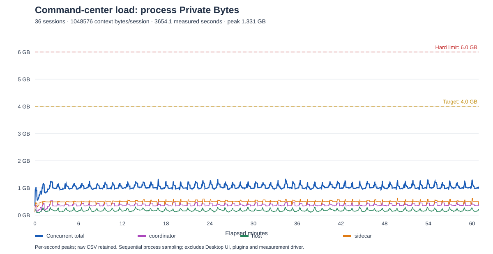

# AI command center: one-hour soak and follow-up progress

- Result: **One-hour fixed-context runtime soak PASS; 4 GB target met with sampling limitations.**
- Local run: 2026-11-08 07:47:48–08:48:42 (UTC+08:00), excluding preparation.
- Scope: 36 independent main sessions, 1,048,576 UTF-8 text bytes/session, same coordinator/Host/sidecar processes across all rounds.
- User gate: sampled peak <=6,000,000,000 bytes; target <=4,000,000,000 bytes.
- Full-workbench AC-07 and the two-hour mixed-resource AC-09 remain unqualified.
- Follow-up: The later harness now waits for a sample collected entirely after
  final worker-result receipt, rejects incomplete workload coverage and counts
  stream samples across all rounds. This report and its raw artifacts describe
  the original run; its 222-ms tail and cadence limits are not retroactively
  repaired by the code change. A short candidate regression is separate from a
  new one-hour qualification.

## Summary

The final candidate ran for **3,654.042 seconds (60 min 54 sec)** and completed
**59 rounds / 2,124 turns**, all with exact input and output verification before
runtime disposal. The last 36 sessions reopened successfully in a new Rust Host.
No round failed, no unexpected runtime/permission/tool/error events occurred,
no persistence diagnostic was recorded, and all owned process closures were
confirmed. The sampled peak was **1,330,749,440 bytes (1.331 decimal GB)**,
below both the 6 GB hard gate and the 4 GB target.

An earlier diagnostic run exposed growing replay-cache memory. It was stopped
after 12 completed rounds, the resource bound was corrected and tested, and the
final candidate started a **new full one-hour run**. The two intervals were not
concatenated. The stopped run remains failed/incomplete in the evidence.

## Memory curve



The SVG uses each series' per-second peak for readability. The total series is
computed from each sample's concurrent process sum, never by adding separate
process peaks. CSV and raw NDJSON retain every sample.

- [Full-resolution CSV](ai-command-center-soak-evidence/fixed/memory.csv)
- [Raw memory samples](ai-command-center-soak-evidence/fixed/memory.ndjson.txt)
- [Curve metrics](ai-command-center-soak-evidence/fixed/curve-metrics.json)
- [Minute minima/means/maxima](ai-command-center-soak-evidence/fixed/minute-memory.json)

## Key metrics

| Metric | Final candidate |
|---|---:|
| Actual workload elapsed | 3,654.042 s |
| Complete rounds / verified turns | 59 / 2,124 |
| Per-round concurrency | 36 streams, provider barrier verified |
| Aggregate all-36-stream overlap | 2,977.765 s (49 min 37.8 s) |
| Input payload verified | 2,227,175,424 bytes |
| Assistant output verified | 196,429,526 bytes |
| Throughput including reset/verification | 34.876 turns/min |
| Sampled Private Bytes peak | 1,330,749,440 B |
| Sample mean | 1,031,642,053 B |
| Sample P50 / P95 / P99 | 1,007,824,896 / 1,189,322,752 / 1,242,726,400 B |
| Samples above 4 GB / 6 GB | 0 / 0 |
| Memory samples | 14,616 |
| Requested sample interval / observed maximum gap | 250 / 595 ms |
| Maximum sequential collection duration | 285.819 ms |
| Round duration P50 / P95 / maximum | 59.680 / 62.692 / 63.648 s |
| Final-stream-to-durable-settlement P50 / P95 / maximum | 1.092 / 2.306 / 2.495 s |
| Sampled pending transcript appends peak | 36 |
| Event-loop window-P99 distribution P95 / maximum | 51.937 / 145.359 ms |
| Post-warmup minute-minimum trend | +0.327 MB/min |
| Final-round reopen verification | 36/36 |
| Owned process cleanup | Confirmed |

The event-loop values are measured in the coordinator using 20-ms histogram
resolution and one-second windows; they are not renderer input-to-paint latency.
Settlement latency is measured from fixture stream end to RuntimeService's durable
turn-ended callback, not stop-request admission. The trend is a linear fit to
minute minima after five minutes, excluding the final partial minute. It is a
diagnostic, not proof of zero leaks or the AC-09 residual-growth acceptance rule.

| Process | Individual sampled peak | CPU time during sampling | Handles first / last / peak | Peak threads |
|---|---:|---:|---:|---:|
| Coordinator + fixture | 546,922,496 B | 165.875 s | 298 / 332 / 335 | 17 |
| Rust Host | 298,635,264 B | 886.469 s | 156 / 167 / 175 | 22 |
| Node sidecar | 623,661,056 B | 161.891 s | 248 / 286 / 289 | 18 |

Individual peaks occur at different times and must not be summed into the main
peak. Initial handles precede load; last handles precede teardown, so this table
does not by itself prove resource leakage. All measured PIDs retained their
original process-start identities through the run.

## Workload and isolation

Each round sends 1 MiB of mixed UTF-8 text (including Chinese and emoji) through
the real AgentHost → RuntimeService → AgentSidecar path. The local deterministic
OpenAI-compatible provider verifies the entire input, waits for all 36 requests,
then emits 100 chunks at requested 500-ms intervals. Every reply is independently
verified through Rust `session.get` after durable settlement.

Between rounds, the fixture releases each session runtime via
`agent.disposeSession` and clears only the already verified synthetic history via
`session.replaceMessages`. The same 36 durable session IDs, AgentHost event
caches, RuntimeService, coordinator process, Rust process and sidecar process stay
alive. No forced GC, AgentHost replay-cache reset, process restart or added idle wait hides growth.
Each final in-progress round finishes in full after the hour expires. Startup,
verification and lifecycle reset explain the difference between elapsed time and
all-stream overlap. This is not one continuously streaming one-hour model reply,
and it is not unbounded long-history growth.

The Host and sidecar use fresh scratch data/HOME/appdata/temp, allowlisted child
environments, empty plugin/subagent catalogs and fixture launch configuration.
There are no real provider calls, secrets, paid APIs or user Desktop/profile
interactions. Source is bundled once at run preparation. Subsequent development
and checks use separate processes and never hot-patch the measured candidate.

Environment: Windows 10 `10.0.19045`, Node `v24.12.0`, six logical CPUs,
25,765,265,408 bytes RAM; current-source Rust debug build. Existing patched Pi
1.4.0 dependencies and host toolchains were reused, with no dependency install.
The sidecar has `--max-old-space-size=2048`, not a process-memory cap.
Lightweight source/type/unit/documentation work ran on the same machine during
part of the soak. Those development processes are not in the application-owned
sample set and may affect scheduling, CPU and sampling intervals.

## Growth diagnosis and correction during follow-up work

The first run retained only count/age bounds on AgentHost's replay log. Over
796.002 seconds of samples, with 12 complete 36-session rounds, its peak reached
1,943,834,624 bytes. Its post-warmup minute-minimum trend was approximately
+62.563 MB/min. Coordinator memory rose while Host/sidecar memory stayed
comparatively stable. The evidence established a concrete replay-retention
problem before hitting 4 or 6 GB; no extrapolated breach is claimed.

Four failing regressions demonstrated missing per-stream UTF-8 byte retention,
missing cross-stream total budget, oversized-event replay gaps and dormant age
expiry. The fix adds:

- 8 MiB of serialized UTF-8 replay envelopes per stream;
- 128 MiB across session and host streams in one EventHub;
- oldest-prefix eviction with shared accounting released on byte/count/age
  eviction; Map-based oldest-entry removal rather than repeatedly shifting arrays;
- existing explicit `resync`/snapshot semantics after eviction, without changing
  live event content, durable transcript history, role checks or wire fields.

The corrected candidate passed the four regressions, all AgentHost tests, and
an RACP client path that attaches after byte eviction, receives a snapshot,
subscribes from its new cursor and continues live without restarting a prompt.
It then ran the full hour reported above. The serialized replay cap is not an
exact JavaScript heap bound; object overhead and other caches remain measured
separately.

The initial run was deliberately stopped through its sampler stop file, causing
the harness's early-exit failure and owned-tree cleanup fallback. Its original
`cleanupConfirmed: false` is retained; a subsequent OS PID query confirmed the
three owned processes no longer existed. This diagnostic run is **not** a
successful one-hour or fully graceful-cleanup result.

- [Stopped control report](ai-command-center-soak-evidence/control/report.json)
- [Control curve](ai-command-center-soak-evidence/control/memory-curve.svg)
- [Control metrics](ai-command-center-soak-evidence/control/curve-metrics.json)
- [Stop and post-cleanup note](ai-command-center-soak-evidence/control/stop-note.json)

## Follow-up task progress

| Planned work | Completed during this task | Remaining gate |
|---|---|---|
| S01/S13 runtime measurement | One-hour repeated fixture, online hard-limit check, CPU/handle/thread/event-loop/round metrics, SVG/CSV export and raw evidence | Full application process inventory, release/reference hardware, mixed child/Worker/tool/UI load |
| S13 resource governance | Implemented and tested byte-bounded replay, then completed the new one-hour run | More workloads and required two-hour/100-cycle residual-growth qualification |
| S02 control contract preparation | [Control contract draft](ai-command-center-control-contracts.md): stable vs concrete identity, atomic quota states, goal consumption, parent/child fencing, durable idempotency and **19 acceptance scenarios** | Contract review/retention decisions; no unimplemented API advertised |
| S02/S03 Host parity preparation | [Capability/handoff inventory](ai-command-center-host-parity.md): 25 capability rows, three distinct execution routes, eight handoff fault cases and platform/workload matrix | Interactive capability qualification and exclusive-owner implementation |
| Validation/spec sync | AgentHost, RACP, host-runtime, harness and curve tests; source typecheck; RPC/replay/process/E2E specs and schedule links synchronized | No schema migration, service deployment, browser exposure or UI feature claimed |

The next implementation gate is exclusive owner/capability-qualified Host
handoff, followed by Rust workspace/reservation/goal/receipt repositories and
all-entry admission. Those must not be declared complete from a passing main-only
load test. M0 remains open for the named platform/native/mobile and mixed-workload
inputs. The two undecided lower overview regions remain undecided.

## Verification and provenance

Executed:

- AgentHost: **78 tests passed**, including four new regressions that failed on
  the old retention implementation.
- RACP: **30 tests passed** across the package; the updated main suite has 25,
  including byte-eviction attach/snapshot/live recovery.
- Host runtime: **187 passed, 3 existing platform skips**.
- Baseline/soak/provider/curve tooling: **18 Node tests passed**.
- Source typecheck passed using current-worktree source mappings and the existing
  patched Pi message augmentation. Targeted Biome checks passed.
- A 25-second multi-round 36-session smoke passed 108 turns. The corrected
  candidate's 12-session multi-round smoke passed 36 turns and reopened 12/12.
- A deliberately tiny memory limit produced a nonzero exit and failure artifact.
- The final report was independently recomputed from raw samples/rounds/telemetry;
  all 3,558 manifest input hashes matched current files. Retained raw artifacts
  match their original scratch files byte-for-byte. Final 36-session reopen
  hashes matched independently generated expected input/output.
- Source diff and `git diff --check` passed; documentation links/pages and the
  VitePress build were validated. No commit, push, PR, deployment or live UI
  verification was requested or performed.

Source HEAD `7674ca53cd839a13f44749de52453111ea192e0d` plus the task's uncommitted
diff incorporates base `fd28eb89866ac513912ed109716e7120cf60f18c`. The recorded
source/dependency manifest digest is
`025f0d7ac74283ee007f7924435e7f6b094487697c6d4faf493ff0fdafc41db5`
(SHA-256 of `JSON.stringify(records)`). Host binary SHA-256:
`104a99fc334c43548cbd384c8b170bb09093de4d8883bb5369e7eacaad93fe4d`.
The manifest and raw artifacts, not the documentation-only HEAD alone, identify
the tested candidate. The control run has its own older input manifest.

| Evidence | File |
|---|---|
| Final raw report | [report.json](ai-command-center-soak-evidence/fixed/report.json) |
| Run configuration | [config.json](ai-command-center-soak-evidence/fixed/config.json) |
| Source/dependency hashes | [build-inputs.json](ai-command-center-soak-evidence/fixed/build-inputs.json) |
| Per-round results | [rounds](ai-command-center-soak-evidence/fixed/rounds.ndjson.txt) |
| Coordinator telemetry | [telemetry](ai-command-center-soak-evidence/fixed/telemetry.ndjson.txt) |
| Reopen verification | [reopen-report.json](ai-command-center-soak-evidence/fixed/reopen-report.json) |
| Independent checks and raw artifact hashes | [verification.json](ai-command-center-soak-evidence/fixed/verification.json) |

## Sampling and acceptance limitations

The requested **sampled one-hour runtime gate passed**, not an absolute maximum
memory guarantee. The initial automated report is PASS. Independent verification
is `PASS_WITH_SAMPLING_LIMITATIONS` and explicitly marks full-lifecycle sampling
coverage as FAIL:

- Target collection was 250 ms, with a maximum observed gap of 595 ms and maximum
  sequential process-read duration of 285.819 ms. `samplingTargetMet` remains
  false. No OS allocation trace was captured.
- Sampling covers 3,653.820 seconds after workload start and ends 2.344 seconds
  after the last provider stream ended. The final **222 ms** of transcript
  verification is not sampled. Startup before the ready barrier, teardown and
  the separate reopen process are also outside the measured window. The original
  report is unchanged; these gaps are recorded in independent verification.
- The sum includes production coordination plus fixture-provider overhead, Rust
  Host and sidecar. It excludes the outer driver/sampler, development commands,
  Desktop renderer, plugins, browser edge, native views and external programs.
- Bytes are not tokens. RACP's current default prompt limit remains 256 KiB;
  this direct AgentHost test does not establish 1-MiB browser/RACP input support
  or real-provider model quality/quotas. The fixture's model window is synthetic.
- Per-round synthetic history is cleared only after verification. Unlimited
  history, session-ID churn, native children/Workers, mixed tools, actual mobile
  suspend/resume, RDP and power-loss recovery were not qualified. Headless
  persistence queues remain in memory; disk/Host failures can still fail a turn
  and must not be acknowledged as success.

## Reproduce

Use the request worktree, a matching prebuilt Host and compatible existing
host dependencies. No package installation is performed by these scripts.

```sh
node --test scripts/e2e/command-center/*.test.mjs scripts/e2e-command-center-curve.test.mjs
node scripts/e2e-command-center-baseline.mjs \
  --host-bin /path/to/pi-desktop-host-core.exe \
  --scratch-dir /path/to/isolated/scratch \
  --sessions 36 --context-bytes 1048576 --context-kind utf8 \
  --ticks 100 --interval-ms 500 --duration-seconds 3600 \
  --budget-bytes 6000000000 --target-bytes 4000000000 --sample-ms 250
node scripts/e2e-command-center-reopen.mjs /path/to/completed-run
node scripts/e2e-command-center-curve.mjs /path/to/completed-run /path/to/output
```

`live.json`, `memory.ndjson`, `rounds.ndjson` and `telemetry.ndjson` are written
during the run. Memory over the hard limit fails the run and triggers owned-tree
cleanup; it is not a kernel-enforced process cap. The final round is not truncated
at exactly 3600 seconds. `.ndjson.txt` retained files are the same raw NDJSON bytes
with a documentation-download-friendly extension.
