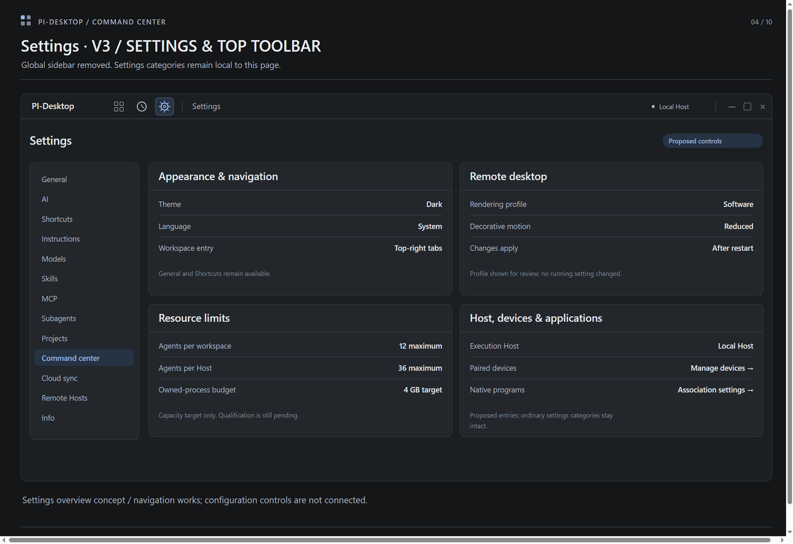
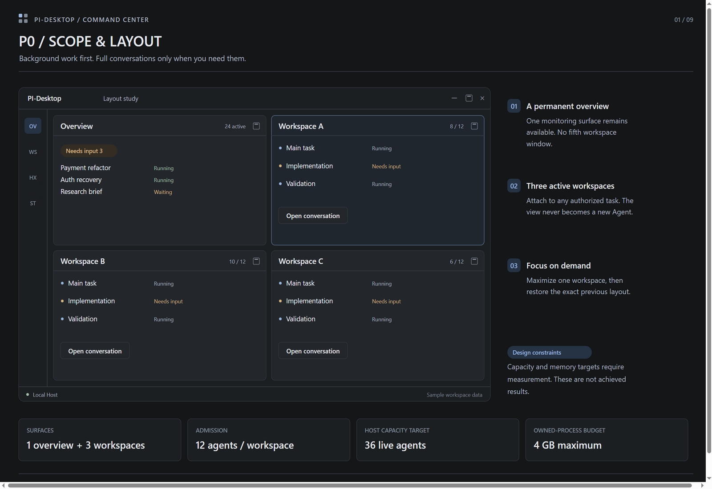
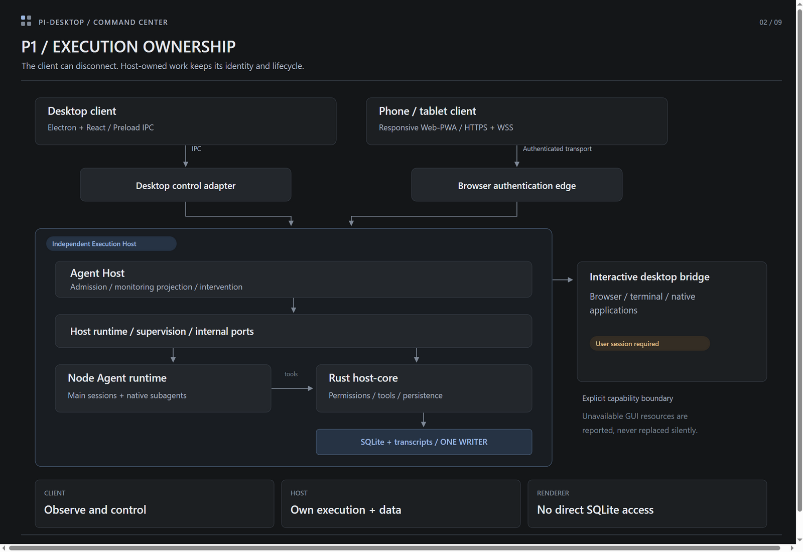
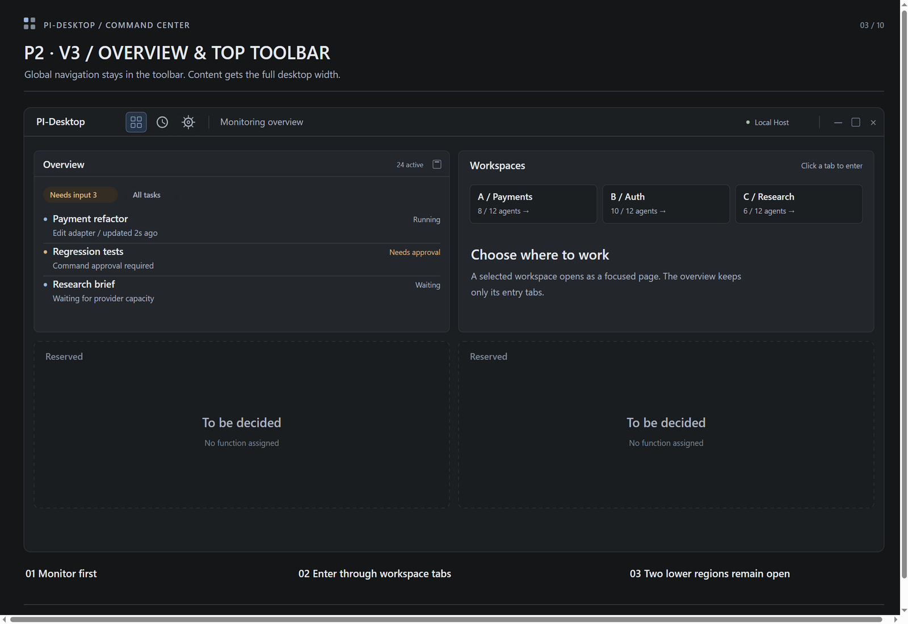
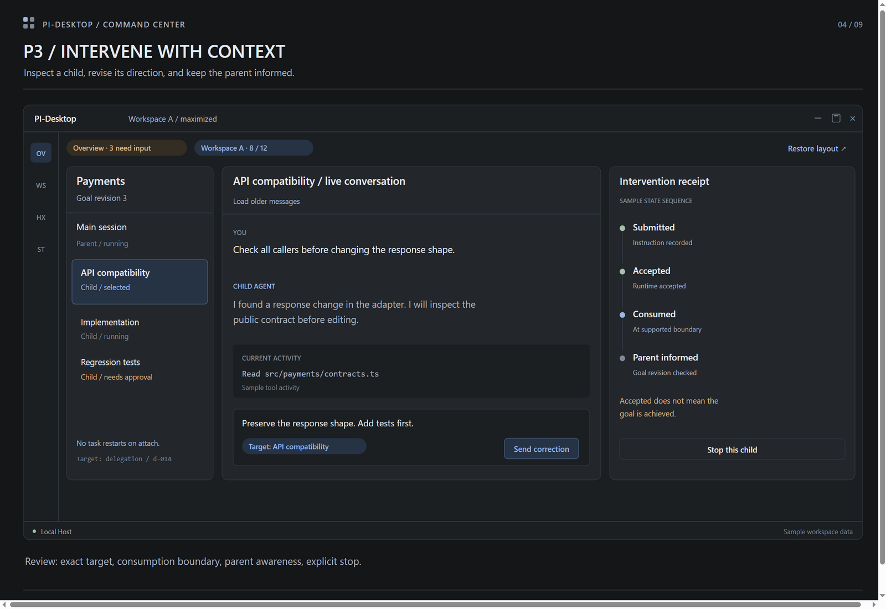
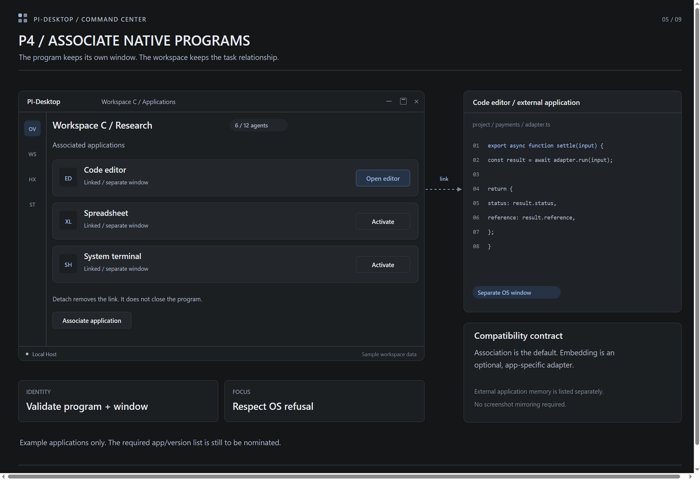
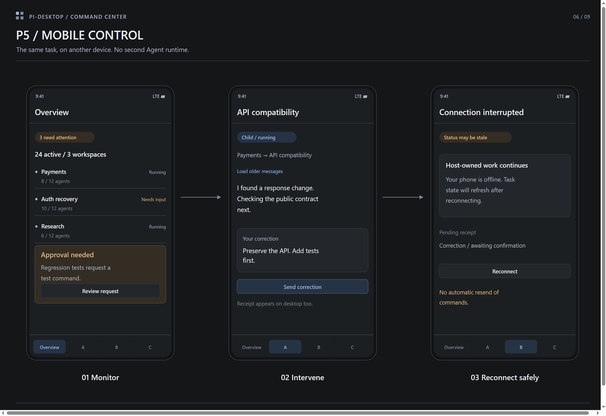
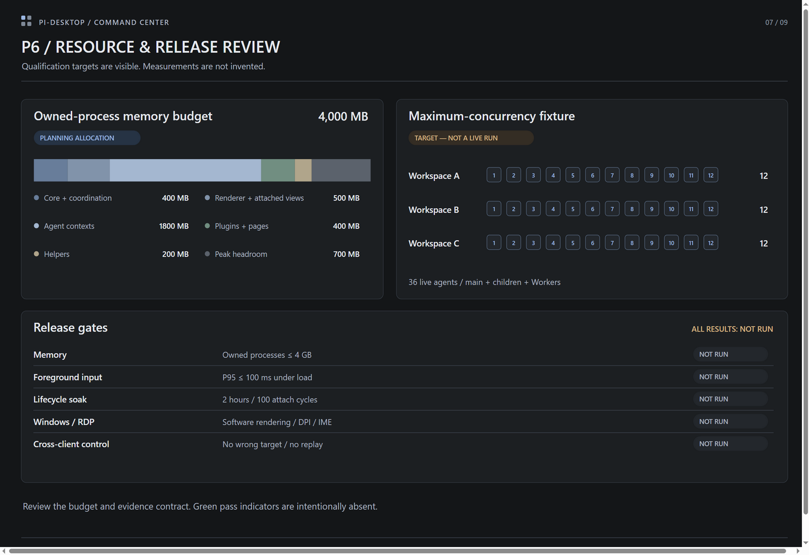
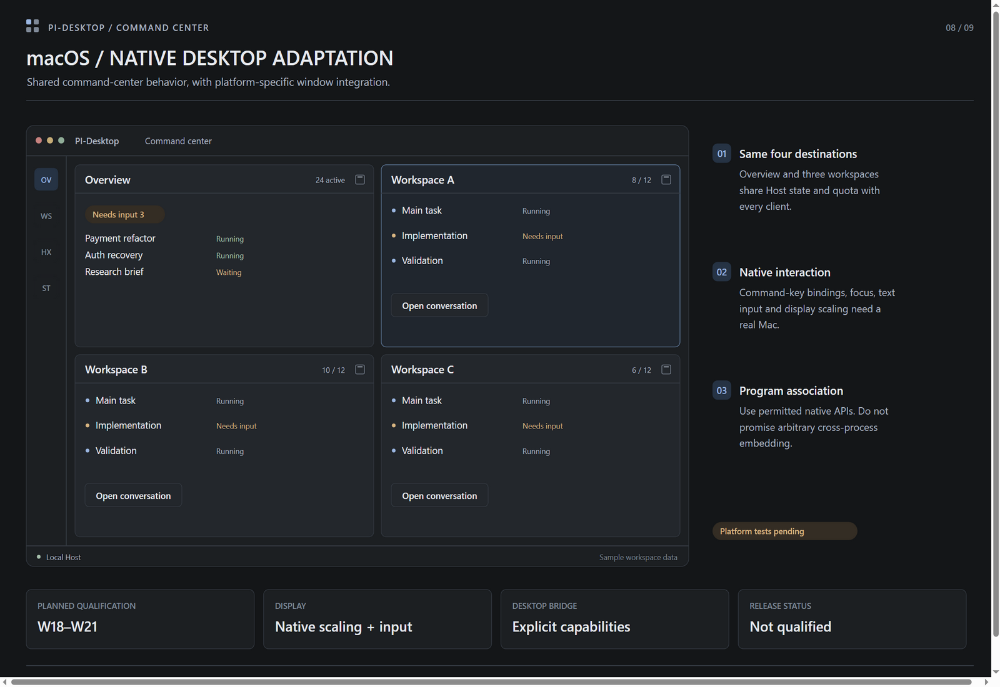
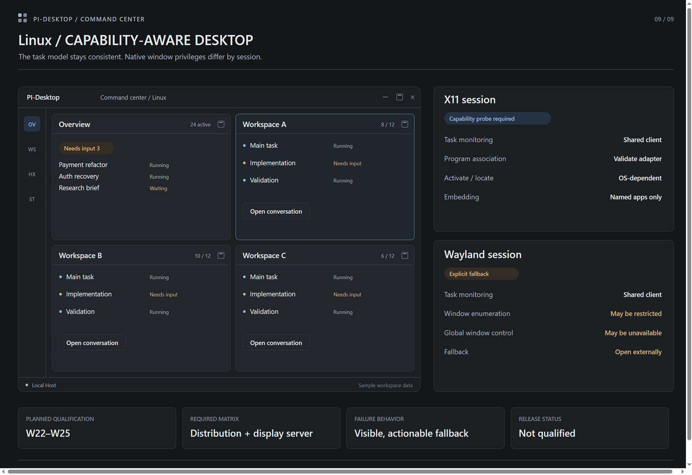

# AI command center: stage design review

- Status: Proposed visual concepts; no implementation or capacity result is implied
- Review version: 3, 2026-11-08; v1/v2 images remain historical references
- Basis: [ADR](../adr/ai-command-center.md), [development design](ai-command-center-development-design.md), [requirements](ai-command-center-requirements.md), [schedule](ai-command-center-schedule.md)
- Deliverables: ten stage/settings entries, three workspace-entry views, SVG/PNG exports at 1600 by 1100, and a clickable local review gallery

## Review method

Open `docs/project/ai-command-center-review.html` locally. It starts at the revised
P2 overview. Click the top-right A/B/C workspace tabs or the top-toolbar icons
for Overview, History and Settings. The three workspace-entry views show
different sample tasks. Other controls are static and do not change application
settings, send prompts, or start work. Stage Previous/Next controls remain available.

The visual direction preserves the existing application's dark neutral surfaces,
compact lists, restrained color and bounded conversation detail. English labels
follow repository conventions. Task names, message content, agent counts and
receipt steps are illustrative. Planned weeks follow the schedule, not a committed
calendar. The current review correction replaces the default side-by-side workspace
previews with top-right entry tabs and two explicitly undecided lower regions.
The previous four-window scope remains a capability/limit proposal; it does not
require all three workspaces to be shown on the overview. V1 boards that still
show that arrangement are historical references, not the latest home-page design.

The image-generation tool returned `IMAGE_NOT_CONFIGURED`; no model-generated
images were produced or retried. These boards were instead drawn deterministically
as editable SVG and rasterized in an isolated software-rendered Electron process.
The selected `magpie-image` service successfully described the existing source
screenshot; subsequent analysis requests returned an unknown-tool routing error.
Final-image semantic review through that service remains unavailable. Local SVG
text geometry, PNG exports and gallery navigation were checked separately.

Editable source: `scripts/design/render-command-center-review.mjs`. Run
`node scripts/design/render-command-center-review.mjs` from the task worktree to
regenerate the SVGs, manifest and gallery. PNGs are separate raster exports and must
be refreshed after any source changes. Source style reference:
`docs/image/readme/chat_en.png`.

## Contents

0. [V3 desktop toolbar and settings](#v3-desktop-toolbar-and-settings)
1. [P0: Scope and layout](#p0-scope-and-layout)
2. [P1: Execution ownership](#p1-execution-ownership)
3. [P2: Monitor and attach](#p2-monitor-and-attach)
4. [P3: Child intervention](#p3-child-intervention)
5. [P4: Native application association](#p4-native-application-association)
6. [P5: Mobile control](#p5-mobile-control)
7. [P6: Resource and release qualification](#p6-resource-and-release-qualification)
8. [Native macOS adaptation](#native-macos-adaptation)
9. [Native Linux capabilities](#native-linux-capabilities)

## V3 desktop toolbar and settings

This revision follows direct review feedback: the overview no longer displays
workspace conversations. The top-right region contains A/B/C entry tabs. Selecting
one opens that workspace as a focused page; the Overview toolbar icon returns without
changing execution ownership. Both lower overview regions stay unassigned and
non-interactive. No task tree, review pane or other function is proposed for them.

The desktop global sidebar is removed. Overview, History and Settings use top-toolbar
icons with hover/focus labels and keyboard-accessible targets. Local Host status also
moves to the toolbar. The content area grows from 1,320 to 1,480 SVG pixels; the
duplicated Back to overview button is removed. The workspace task list and Settings'
category directory are contextual content and remain available.

Existing General, AI, Shortcuts, Instructions, Models, Skills, MCP, Subagents,
Projects, Cloud sync, Remote Hosts and Info categories stay visible in Settings.
The proposed Command center page still groups navigation, remote-desktop profile,
resource targets and Host/device/application management. These are review controls;
the 4 GB value is a qualification target, not measured enforcement.

[Settings SVG](../image/command-center-review/settings-command-center-v3.svg)

Workspace entry views: [Payments](../image/command-center-review/workspace-a-entry-v3.png),
[Auth](../image/command-center-review/workspace-b-entry-v3.png),
and [Research](../image/command-center-review/workspace-c-entry-v3.png).

The current drawing source is `scripts/design/render-command-center-review-v3.mjs`,
called by the existing render command; `command-center-review-gallery.mjs` owns
the standalone gallery. Toolbar and workspace navigation are clickable. History
opens a small sample list only; no user history is read. Settings forms and Send
remain static concepts. The [v2 workspace view](../image/command-center-review/workspace-a-entry-v2.png)
is retained for comparing the removed global sidebar.

## P0: Scope and layout

Proposed phase: W1-W2. Review one permanent overview, three workspaces and the
separate surface/admission/memory constraints. The miniature task lists show the
information hierarchy rather than a production data model.

[Editable SVG](../image/command-center-review/p0-scope-layout.svg)

- Is one overview plus three workspaces sufficient for daily supervision?
- Does the default low-detail view surface enough information before attachment?
- Confirm that 12/36 agents and 4 GB are design targets requiring qualification.

## P1: Execution ownership

Proposed phase: W2-W5. Review clients, authenticated adapters, independent execution
and the interactive desktop bridge. The diagram preserves a single Rust-owned
database writer and separates client connection from task execution lifetime.

[Editable SVG](../image/command-center-review/p1-execution-architecture.svg)

- Client disconnect must not silently terminate qualified Host-owned work.
- Desktop and mobile observe the same task identity and admission budget.
- GUI-dependent resources require an available, explicit desktop bridge.

## P2: Monitor and attach

Revised phase concept: monitoring at upper left, workspace entry tabs at upper
right, and two undecided regions below. Selecting a tab enters a separate focused
workspace view. Conversations are no longer pre-expanded on the overview.

[Editable SVG](../image/command-center-review/p2-overview-v3.svg)

- Review the right-side tab entry and the clear Settings destination.
- Leave the two lower regions undecided; their purpose is not inferred.
- Verify A/B/C navigation, return to overview, and retained execution context.
- The [v1 P2 board](../image/command-center-review/p2-monitor-attach.png) is retained for comparison only.

## P3: Child intervention

Proposed phase: W6-W9. A single workspace is maximized. The permanent overview is
reachable through the attention entry, while parent/child identity, history,
correction and receipt states are visible together.

[Editable SVG](../image/command-center-review/p3-child-intervention.svg)

- Is the correction target unmistakable before Send?
- Review submitted, accepted, consumed and parent-notified states separately.
- Stop does not imply rollback; acceptance does not prove semantic goal completion.

## P4: Native application association

Proposed phase: W8-W11. Workspace C associates a separate code-editor window.
The drawn external editor is deliberately outside the PI-Desktop window boundary.
Application names are examples pending the required compatibility list.

[Editable SVG](../image/command-center-review/p4-native-association.svg)

- Confirm that association and direct embedding are visibly different capabilities.
- Detach removes the association and must not close the external program.
- Required application versions, privileges and workflows still need nomination.

## P5: Mobile control

Proposed phase: W10-W14. Three phone states show monitoring, task intervention and
disconnection. The same four logical destinations use compact navigation instead
of four simultaneously visible windows. No local phone Agent runtime is implied.

[Editable SVG](../image/command-center-review/p5-mobile-control.svg)

- Review the attention queue, task context and correction controls on a phone.
- A disconnected client shows stale/unknown state while Host-owned work continues.
- Reconnection recovers receipts and history; it never silently resends a mutation.

## P6: Resource and release qualification

Proposed phase: rolling validation through W14. This is an engineering review board,
not a live product telemetry screen. Budget allocations sum to 4,000 decimal MB.
The thirty-six positions represent the intended fixture, not measured active work.
Every result is explicitly NOT RUN.

[Editable SVG](../image/command-center-review/p6-resource-qualification.svg)

- All application-owned processes remain inside the accounting boundary.
- The maximum-load test requires thirty-six actual overlapping executions.
- No green pass state or resource usage claim is substituted for measured evidence.

## Native macOS adaptation

Proposed qualification: W18-W21. Preserve the common four-surface model with macOS
window chrome, command-key interaction and explicit native capability checks.

[Editable SVG](../image/command-center-review/macos-platform.svg)

- Validate keyboard behavior, text input, scaling and focus on a real Mac.
- Program association uses permitted native APIs and visible permission outcomes.
- This is a proposed platform view, not a claim of arbitrary application embedding.

## Native Linux capabilities

Proposed qualification: W22-W25. The task/monitoring model remains shared, while
native program capabilities are qualified separately for X11 and Wayland.

[Editable SVG](../image/command-center-review/linux-platform.svg)

- Review explicit unsupported states and the Open externally fallback.
- Qualify actual distributions and display servers before claiming support.
- No blanket cross-platform native-window control is implied by the shared UI.

## Feedback format

Feedback can identify a board and a concrete decision, for example:
`P3 / move the correction composer beside the child selector` or
`P2 / make pending approvals more prominent than activity timestamps`.
Review layout, information priority, target clarity and lifecycle semantics first.
Implementation estimates, dates and performance guarantees remain governed by the
linked proposal documents and their acceptance evidence.
